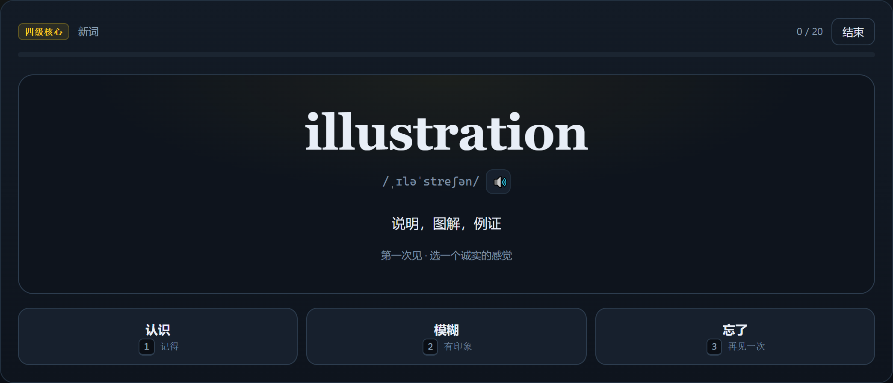
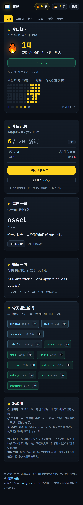

<div align="center">

# Word Quest

**CET-4 / CET-6 / Postgraduate / IELTS — one page, 10 minutes a day.**

No sign-up · Works offline · Optional cloud sync · Single file, no framework, no backend

[**Open the app →**](https://logic77lhl.github.io/word-checkin/)　·　[Setup guide (zh)](guide.html)　·　[中文](README.md)

[](https://logic77lhl.github.io/word-checkin/)
[](LICENSE)
[](https://github.com/logic77lhl/word-checkin/stargazers)
[](#data-and-privacy)


</div>

## Why

Most vocabulary apps ask you to sign up, install something, and wait for a bundle to load before you learn a single word. Word Quest is a **single HTML page**: open it, learn, close it. Progress lives in your own browser by default; sign in only if you want it on another device.

## Quick start

1. Open **<https://logic77lhl.github.io/word-checkin/>**
2. Pick a word list (CET-4 / CET-6 / Postgraduate / IELTS) and a daily goal (10–50 new words)
3. Hit **Start today's session**, recall the meaning, flip the card, rate it honestly
4. Switch to **Listening & Speaking** for dictation, shadowing and sentence drills

## Features

| Area | What you get |
| --- | --- |
| **Learn** | 12,254 words across 4 lists (CET-4 2607 · CET-6 2345 · Postgraduate 3727 · IELTS 3575); import your own list; due reviews queued automatically |
| **Practice** | 10-question quiz; dictation (spell what you hear, or pick the meaning); shadowing with word-level similarity where the browser supports it; 60 sentence drills |
| **Track** | Daily check-in, streaks, 12-week heatmap, 30-day chart, 18 badges, XP and levels, memory-state breakdown |
| **Sync** | JSON export/import; optional Supabase sign-in (GitHub or email magic link) with revision-based optimistic locking and field-level merge |
| **Offline** | No third-party dependencies — `index.html` works from `file://`; pronunciation uses the built-in `speechSynthesis` |

## Screenshots

| Today | Study card |
| --- | --- |
|  |  |
| **Stats** | **Mobile** |
|  |  |

> Screenshots use demo data (14-day streak, 72 learned words), not a real account.

## Data and privacy

- **Signed out:** writes only to `localStorage`. No network requests beyond loading the word-list files.
- **Signed in:** two endpoints only — Supabase Auth and the `public.progress` table.
- **Row-level security:** every policy is `auth.uid() = user_id`; you can only read or write your own row.
- **Keys:** only the publishable key ships to the browser. The `service_role` key never does.
- **Leaving:** export a JSON backup any time; signing in on another device syncs automatically.

## Run locally

```bash
git clone https://github.com/logic77lhl/word-checkin.git
cd word-checkin
node scripts/serve.mjs   # http://localhost:4173
```

There is no build step and no `npm install`. Double-clicking `index.html` also works.

## Scheduling

Each word has a memory box `b` and a due date:

| Rating | Box change | Next review |
| --- | --- | --- |
| Known | `b + 1` (max 8) | 1 / 2 / 4 / 7 / 15 / 30 / 60 / 120 days |
| Fuzzy | stays (min 1) | tomorrow |
| Forgotten | back to 1 | today (repeats this session) |

`b >= 6` counts as mastered (next interval ≥ 30 days). The logic lives in `grade()` inside `index.html`; swapping in SM-2 or FSRS means changing only that function.

## Custom word lists

One word per line; spaces, commas, tabs, `|` or `:` all work as separators:

```
abandon 放弃；抛弃
resilient 有韧性的
serendipity, 意外发现珍奇事物的运气
```

## Cloud sync (optional)

Without configuration the app runs fully local. To enable accounts:

1. Create a Supabase project, run the SQL from the [Chinese README](README.md#云同步可选) (table + RLS)
2. Set the site URL under Authentication → URL Configuration
3. Generate `config.js` from environment variables with `scripts/gen-config.mjs`

## Roadmap

- [x] Four word lists + custom lists
- [x] Check-in, heatmap, badges, XP
- [x] Quiz, dictation, shadowing, sentence drills
- [x] Supabase sign-in and cross-device sync
- [ ] Switchable FSRS scheduler
- [ ] Example sentences and collocations
- [ ] PWA install + offline cache
- [ ] Shareable progress card
- [ ] More question types

## Contributing

Issues and PRs are welcome. Please open an issue first, keep one PR to one change, and include a source when correcting a word entry.

## License

- **Application code:** [MIT](LICENSE)
- **Word data:** derived from [qwerty-learner](https://github.com/Kaiyiwing/qwerty-learner), subject to its upstream license (GPL-3.0).
- **Vendored dependency:** supabase-js v2 (MIT).
