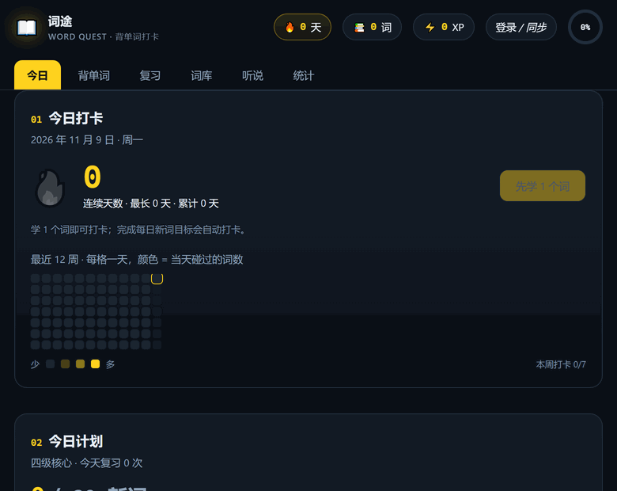
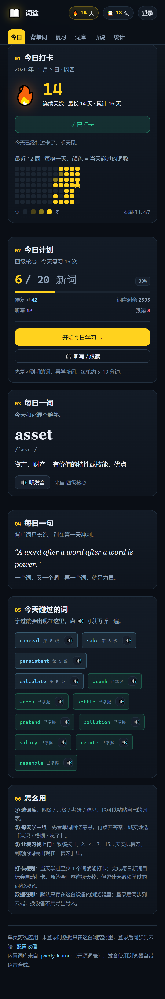

<div align="center">

# 词途 · Word Quest



**打开链接就能背。** 四六级 / 考研 / 雅思，内置 12,254 个词。

[**立即打开 →**](https://logic77lhl.github.io/word-checkin/)　·　[配置教程](guide.html)　·　[English](README.en.md)

[](https://logic77lhl.github.io/word-checkin/)
[](LICENSE)
[](https://github.com/logic77lhl/word-checkin/stargazers)
[](#数据与隐私)

</div>

| | |
| --- | --- |
| **是什么** | 一个 HTML 文件的背单词工具。打开就是今天的队列，不注册、不安装、不加载框架。 |
| **给谁用** | 在备考四六级 / 考研 / 雅思的人；不想为了背单词再装一个 App 的人。 |
| **怎么用** | 点上面的链接；或把页面存成 `index.html` 双击打开，离线也能背。 |

进度只存在你自己的浏览器里。换设备再登录同步，不登录功能完全一样。

## 30 秒上手

1. 打开 **<https://logic77lhl.github.io/word-checkin/>**
2. 选词库（四级 / 六级 / 考研 / 雅思），设每天 10–50 个新词
3. 点「开始今日学习」→ 看英文回忆 → 翻开 → 诚实选「认识 / 模糊 / 忘了」
4. 想练听说就切到「听说」：听写、跟读、句子训练

不用注册，不用安装，不用配置。第一次打开就能背。

## 功能

| 模块 | 你能做什么 |
| --- | --- |
| **学** | 4 个词库共 12,254 词（四级 2607 · 六级 2345 · 考研 3727 · 雅思 3575）；粘贴自己的词表；每日新词 10/15/20/30/50 可调；到期的复习词自动排进队列 |
| **练** | 10 题小测（看英文选中文）；听写（听音写词 / 听音选义，可慢速重播）；跟读（录音回放，支持时给词级相似度）；60 句句子听写与影子跟读 |
| **记** | 每日打卡、连续天数、最长连续、累计天数；最近 12 周热力图；30 天柱状图；18 个自动判定的徽章；XP 与等级；记忆状态分布 |
| **同步** | 导出 / 导入 JSON；可选 Supabase 登录（GitHub / 邮箱魔法链接），带版本号乐观锁和逐字段合并规则 |
| **离线** | 无第三方依赖，双击 `index.html` 也能用；发音走浏览器自带 `speechSynthesis`，不联网 |

## 截图

| 今日 | 背单词 |
| --- | --- |
|  |  |
| **统计** | **手机端** |
|  |  |

> 截图使用演示数据（14 天连续打卡 / 72 个已学词），不是真实账号。

## 数据与隐私

| 场景 | 会发生什么 |
| --- | --- |
| 未登录 | 只写浏览器 `localStorage`，除词库文件外**不发任何网络请求** |
| 登录后 | 只有两类请求：Supabase Auth、`public.progress` 表 |
| 云端权限 | 表上开了 RLS，每条策略都是 `auth.uid() = user_id`，只能读写自己那一行 |
| 前端密钥 | 只用 publishable key；`service_role` / secret key 永远不进前端 |
| 换设备 | 登录同一账号自动同步；也可以导出 JSON 手动搬 |
| 清除数据 | 统计页 →「清空全部」（登录时会连云端一起清） |

本地存储 key：游客 `wordquest-v1`，登录后 `wordquest-v1:<user_id>`。同一台电脑换账号不会串数据。

## 本地运行

```bash
git clone https://github.com/logic77lhl/word-checkin.git
cd word-checkin
node scripts/serve.mjs
# 打开 http://localhost:4173
```

没有构建步骤，也没有 `npm install`。也可以直接双击 `index.html`（`file://` 下词库同样能加载）。

## 复习算法

每个词有一个记忆等级 `b` 和下次复习日期 `due`：

| 评分 | 等级变化 | 下次复习 |
| --- | --- | --- |
| 认识 | `b + 1`（最高 8） | 1 / 2 / 4 / 7 / 15 / 30 / 60 / 120 天后 |
| 模糊 | 保持当前等级（最低 1） | 明天 |
| 忘了 | 回到 1 | 今天（本轮会再出现一次） |

`b >= 6` 视为「已掌握」（下次间隔 ≥ 30 天）。算法在 `index.html` 的 `grade()` 里，想换成 SM-2 / FSRS 只需要改这一段。

## 自定义词表

在「词库与计划 → 导入自己的词表」里，每行一个词，下面几种写法都认：

```
abandon 放弃；抛弃
resilient 有韧性的
serendipity, 意外发现珍奇事物的运气
give up	放弃
```

单词和释义之间用空格、逗号、制表符、`|` 或 `:` 分隔，重复词自动跳过。

## 云同步（可选）

不配置也能用，页面会自动进「纯本地模式」。要用账号和跨设备同步，三步：

1. Supabase 新建项目，在 SQL Editor 建表并开 RLS（完整 SQL 见下方折叠）
2. Authentication → URL Configuration 填站点地址，按需开 GitHub / Email 登录
3. 用 `scripts/gen-config.mjs` 从环境变量生成 `config.js`（已在 `.gitignore`）

更细的步骤、自检按钮和错误对照表在 **[配置教程](guide.html)** 里。

<details>
<summary>建表 SQL（点开复制）</summary>

```sql
create table public.progress (
  user_id     uuid primary key references auth.users(id) on delete cascade,
  data        jsonb not null default '{}'::jsonb,
  revision    bigint not null default 1,
  updated_at  timestamptz not null default now(),
  constraint progress_size check (pg_column_size(data) <= 2097152)
);

alter table public.progress enable row level security;

create policy "own progress select" on public.progress
  for select using (auth.uid() = user_id);
create policy "own progress insert" on public.progress
  for insert with check (auth.uid() = user_id);
create policy "own progress update" on public.progress
  for update using (auth.uid() = user_id) with check (auth.uid() = user_id);
create policy "own progress delete" on public.progress
  for delete using (auth.uid() = user_id);

-- RLS 负责限定到「只有自己那一行」，所以这里给登录用户表级权限
grant select, insert, update, delete on public.progress to authenticated;
```

</details>

**同步怎么工作**：改动停下来 1.5 秒后自动上传；切后台 / 关页面时尽力补一次。写入带 `revision` 乐观锁，版本对不上就拉最新 → 按规则合并 → 重试最多 3 次。合并规则是单词按 `last` 取较新、每日记录按天取并集、徽章取并集、技能计数取 `max`。第一次在设备上登录且本机有游客进度时，会让你选「合并 / 只用云端 / 只用本机」。

## 部署到 GitHub Pages

站点通过 GitHub Actions 发布（因为 `config.js` 要从 Secrets 生成，不能提交）：

1. 仓库 Settings → Pages → Source 选 **GitHub Actions**
2. `gh secret set WQ_SUPABASE_URL` / `gh secret set WQ_SUPABASE_ANON_KEY`
3. push 到 `main`，`.github/workflows/pages.yml` 自动生成 `config.js` 并发布

只要纯本地版、不要账号功能，也可以让 Pages 直接从 `main` 根目录发布，不生成 `config.js` 即可。

<details>
<summary>目录结构</summary>

```
word-checkin/
├─ index.html            # 界面 + 逻辑 + 样式（单文件）
├─ login.html            # 登录 / 注册页（Supabase Auth）
├─ guide.html            # 配置教程（建表、环境变量、GitHub 登录、自检）
├─ config.js             # 自动生成，含 Supabase URL 与 publishable key（不进仓库）
├─ js/
│  ├─ cloud.js           # 云同步层：推送、乐观锁、合并规则
│  └─ vendor/supabase.js # supabase-js v2 UMD（MIT）
├─ data/
│  ├─ cet4.js            # 四级词库（window.__BOOKS.cet4）
│  ├─ cet6.js
│  ├─ kaoyan.js
│  ├─ ielts.js
│  └─ books.json         # 构建统计
├─ research/
│  └─ open-source-language-learning.md   # 开源项目调研
├─ .github/workflows/
│  └─ pages.yml          # 从 Secrets 生成 config.js 并发布
└─ scripts/
   ├─ serve.mjs          # 本地静态服务器
   ├─ gen-config.mjs     # 从环境变量生成 config.js
   └─ build-books.mjs    # 把原始 JSON 压成 data/*.js
```

</details>

## 词库来源

词库来自开源项目 [qwerty-learner](https://github.com/Kaiyiwing/qwerty-learner) 的 `public/dicts`。原始文件较大，仓库里只保留压缩后的 `data/*.js`。

需要重建时，把原始 JSON 下载到 `data-src/` 再跑脚本：

```powershell
$base = "https://raw.githubusercontent.com/Kaiyiwing/qwerty-learner/master/public/dicts/"
foreach ($f in "CET4_T.json","CET6_T.json","KaoYan_3_T.json","IELTS_3_T.json") {
  curl.exe -L -o "data-src/$f" "$base$f"
}
node scripts/build-books.mjs
```

脚本会去重、清理标点、把音标里的 `'` 规范成 `ˈ`，输出浏览器可直接 `<script>` 加载的格式。词条结构是 `[单词, 释义, 音标]`，改 `scripts/build-books.mjs` 里的 `books` 数组就能加词库（记得同步 `index.html` 里 `BOOK_META` 的 `total`）。

## 这个项目不是什么

- **不是保过班**。它只负责安排复习、记录进度，不承诺提分。
- **不是词典**。释义和音标来自开源词表，个别条目可能有排版或风格差异，以词典为准。
- **不是 FSRS**。目前是固定间隔表，想升级看上面的「复习算法」。
- **不是发音评分器**。跟读只做词级识别，不是音素级打分。
- **不采集数据**。没有埋点、没有统计脚本、没有第三方字体 CDN。

## 路线图

- [x] 四个词库 + 自定义词表
- [x] 打卡 / 热力图 / 徽章 / XP
- [x] 小测、听写、跟读、句子训练
- [x] Supabase 登录与跨设备同步
- [ ] 可切换 FSRS 调度
- [ ] 例句与搭配（现在只有释义和音标）
- [ ] PWA：安装到桌面 + 离线缓存
- [ ] 分享卡片：把连续天数和热力图导成图片
- [ ] 看义选词、拼写提示等更多题型
- [ ] 移动端手势与长按操作

## 参与贡献

| 方式 | 怎么做 |
| --- | --- |
| 报 bug | [开 issue](https://github.com/logic77lhl/word-checkin/issues/new)，附浏览器版本、复现步骤、截图 |
| 词条纠错 | 说明词条 + 错在哪 + 依据（词典截图或链接） |
| 加词库 | 改 `scripts/build-books.mjs` 的 `books` 与 `BOOK_META`，附数据来源和许可 |
| 翻译 | 目前有中 / 英两份 README，欢迎补日文、韩文 |
| 点 Star | 见文末 |

提交 PR 前请先开 issue 说明要做什么，一个 PR 只做一件事；改词库请一并给出依据。

## 分享与传播

这个项目没有推广预算，能被人看到全靠使用者转发。如果你觉得有用：

- **发给一个正在备考的人**，比任何榜单都有效；
- 复制这段话发到群里 / 朋友圈 / 即刻：

  > 找到个免注册的背单词网页，四六级考研雅思都有，打开就能背，数据存在本地，还能登录同步。https://logic77lhl.github.io/word-checkin/

- 在你自己的项目 README 里放个链接或 badge：

  ```markdown
  [](https://logic77lhl.github.io/word-checkin/)
  ```

- 只需要词库？`data/*.js` 可以直接取用（注意遵守上游许可，见下）。

## Star

如果它帮你多背了 10 个词，点个 **Star** 就是最好的鼓励 —— 也是让更多人看到它的唯一方式。

[](https://github.com/logic77lhl/word-checkin/stargazers)

## 许可

- **应用代码**：[MIT](LICENSE)
- **词库数据**：转自 [qwerty-learner](https://github.com/Kaiyiwing/qwerty-learner)，遵循其上游许可（GPL-3.0）。二次分发词库前请自行确认上游条款。
- **第三方依赖**：`js/vendor/supabase.js` 为 supabase-js v2（MIT）。

## 调研

- [开源英语学习项目调研：听说读写，谁能打？](research/open-source-language-learning.md)
